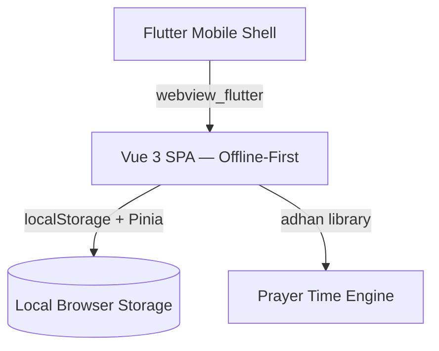

# إقامة | Iqamah — Salah Habit Establishment Platform

[](CHANGELOG.md)
[](https://vuejs.org/)
[](https://flutter.dev/)
[](https://tailwindcss.com/)
[](#)
[](http://makeapullrequest.com)
[](LICENSE)

**Iqamah (إقامة)** is a local-first Salah habit companion for users in Bangladesh. It tracks prayer punctuality, missed prayers, Qaza obligations and analytics without an account or a mandatory server. Select one of Bangladesh's 64 districts during onboarding or in Settings to calculate district-center prayer estimates offline.

**Current implementation is v1.1.4-beta.1.** See [release verification and blockers](docs/release-readiness.md) and [design system](docs/design-system.md).


---

## 🏗️ Architecture Overview

As of **v1.1.4-beta.1**, the platform operates in a **fully offline, hybrid model**. The mobile client wraps the compiled offline-first Vue client inside a native WebView container, achieving 100% feature and design parity.



### 1. Web Client (Vue 3 + Vite)
A local-first Single Page Application:
- **Tailwind CSS v4:** Forest-green/ivory semantic tokens, class-based light/dark themes and a fluid responsive shell.
- **Pinia Store (`usePrayerStore`):** All prayer logs, Qaza records, streaks, and analytics computed and persisted in `localStorage`. No HTTP calls.
- **adhan (JS):** One shared astronomical calculation service for Home and the full timetable. District coordinates are bundled; no GPS permission is requested. Displays use `Asia/Dhaka` (UTC+06:00).
- **OnboardingView:** Captures optional name, language, gender and required district — stored locally. Existing profiles can select their district in Settings without restarting onboarding.

### 2. Mobile Client (Flutter)
A lightweight Flutter WebView shell:
- **webview_flutter:** Serves the compiled Vue 3 Single Page Application locally via asset bundler, ensuring 100% UI/UX parity.
- **Platform-Safe Wrapper:** Uses Dart conditional imports (`webview_stub.dart`, `webview_mobile.dart`, `webview_web.dart`) to safely load platform-specific WebViews across Android, iOS, Web (Chrome), and Desktop.
- **Native shell:** Bundles `mobile/assets/web/index.html`, handles resume/back/load errors and uses dark forest-green native chrome. Native chrome does not yet synchronize with the web light theme.
- **Persistence:** Active Android/iOS screens use WebView LocalStorage, **not SQLite**. The older Dart providers/SQLite service remain dormant and are not automatically migrated or synchronized. Existing SQLite files are not deleted.

---

## ✨ Features

| Feature | Web | Mobile |
|---------|-----|--------|
| 5-prayer daily tracker with explicit Log/Edit form | ✅ | Shared web UI |
| Detailed log sheet (Waqt, Jamaah, Tasbih, Quran notes) | ✅ | ✅ |
| Swipe gestures (delete / mark missed) | Not implemented | Not in active WebView UI |
| Pending/fulfilled Qaza ledger, prayer filters and fulfill action | ✅ | Shared web UI |
| Streak counter | ✅ | ✅ |
| Analytics (punctuality split, missed reasons) | ✅ | ✅ |
| Home timetable, next-prayer countdown and district preferences | ✅ | Bundled; device verification pending |
| Approximate caution windows (not universal religious boundaries) | ✅ | Shared web UI |
| Hijri date display (Intl estimate, not local moon-sighting authority) | ✅ | Shared web UI |
| JSON backup export / import | ✅ | ✅ |
| Reset Application (wipe all data) | ✅ | ✅ |
| Bilingual (Bengali / English) | ✅ | ✅ |
| Gender-aware Hayd/Nifas logging | ✅ | ✅ |
| Offline — no internet required | ✅ | ✅ |
| Light + Dark web theme | ✅ | Web theme; native chrome remains dark |

---

## 💻 Web Client — Quick Start

### Prerequisites
- [Node.js 24](https://nodejs.org/) for the current toolchain
- [Bun 1.4.2](https://bun.sh/) (the committed lockfile is `client/bun.lock`; there is no npm lockfile)

### Setup
```bash
cd client
bun install --frozen-lockfile --ignore-scripts
bun run dev
```
The app opens at `http://localhost:5173`. No backend needed.

### Production Build
```bash
bun run build      # TypeScript check + Vite build
bun run test:unit -- --run   # Run the full Vitest suite
bun run lint       # ESLint + Oxlint
```

---

## 📱 Mobile Client — Quick Start

### Prerequisites
- [Flutter SDK (stable)](https://docs.flutter.dev/get-started/install)
- Android SDK / Xcode (for device targets)

### Setup
```bash
cd mobile
flutter pub get
flutter run          # Connect an Android/iOS device or emulator
```

**First rebuild the embedded web asset from the repository root:**
```bash
bash scripts/build-mobile-web.sh
```
CI downloads the current validated web bundle before Flutter builds. A stale committed
HTML file must not be treated as evidence that current Vue changes are present on mobile.

### Supported Platforms
| Platform | Status |
|----------|--------|
| Android | Primary WebView target; physical-device QA/signing required |
| iOS | WebView implementation present; Xcode/macOS verification required |
| Web | Flutter iframe shell; standard JS release build (not WASM SQLite) |
| Linux/Desktop | Informational fallback; no working desktop WebView |

---

## 📁 Project Structure

```
Iqamah/
├── client/                    # Vue 3 offline SPA
│   └── src/
│       ├── assets/            # Tailwind CSS + fonts
│       ├── stores/            # Pinia (auth.ts, prayer.ts)
│       ├── views/             # Dashboard, Qaza, Analytics, SalahTime, Settings, Guide, Onboarding
│       └── router/            # Route guards
├── mobile/                    # Flutter offline companion
│   └── lib/
│       ├── main.dart          # Native shell and safe areas
│       ├── webview_widget/    # Active platform wrappers
│       ├── providers/         # Legacy, not wired into active shell
│       ├── services/          # Legacy DatabaseHelper (SQLite)
│       └── l10n/              # strings.dart (Bengali + English)
├── docs/                      # Domain model & design system documentation
├── CHANGELOG.md               # Version history
└── README.md
```

---

## 🧪 Testing

### Web Client (Vitest)
```bash
cd client
bun run test:unit -- --run
```

### Mobile (Flutter)
```bash
cd mobile
flutter test
flutter analyze
```

---

## 🐳 Docker Deployment

The application can be built and deployed as a lightweight static web container:

```bash
# Build the Docker image
docker build -t iqamah-app .

# Run the container
docker run -p 8080:80 iqamah-app
```

### Backup and restore

Settings exports the existing `version: "1.1.0"` JSON format with all stored dates,
stable IDs, notes and embedded pending/fulfilled Qaza. Restore validates the whole file
before a single LocalStorage write and merges only new or identical records. Unsupported
versions, invalid relationships and conflicting records are rejected without replacing
existing records. Export current data before restoring a different history. Profile
district/theme/language settings are not included in this prayer-record backup.

Legacy Dart SQLite backups (`version: 1`, integer) are a different format and are not
accepted by the web restore flow. Migration between those formats is not implemented.
LocalStorage is unencrypted, scoped to the browser/WebView origin, and may be lost on
uninstall, clearing site data or changing the origin. Keep external backups.

### Hosting and offline behavior

Serve `client/dist/` on a static host. Hash routes (`/#/qaza`, etc.) need no per-route
server rewrites. The JS, CSS and required Bengali/icon fonts are inlined into `index.html`;
no Google Fonts requests are needed. A hosted page still needs its first HTML download:
there is no service worker guaranteeing offline cold starts for hosted web pages. The
Android/iOS shell instead starts from its bundled HTML asset.

---

## 🤝 Contributing

Contributions are welcome! Please read [CONTRIBUTING.md](CONTRIBUTING.md) for branch naming conventions, coding standards, and how to submit a pull request.

Please review [CODE_OF_CONDUCT.md](CODE_OF_CONDUCT.md) before participating.

## 📄 License

Distributed under the GNU GPLv3 License. See [LICENSE](LICENSE) for more information.
