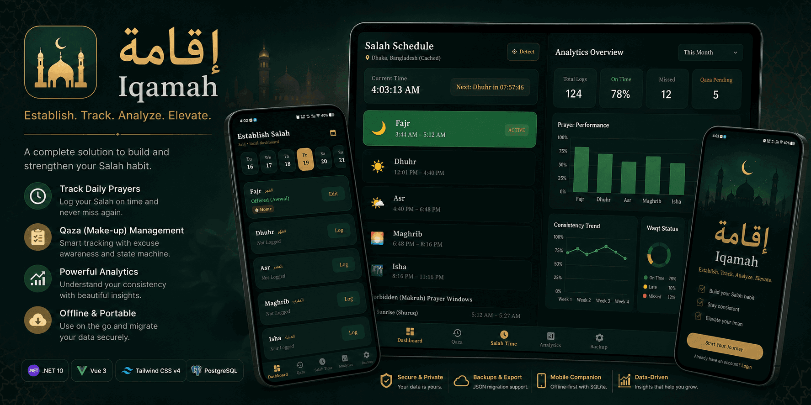
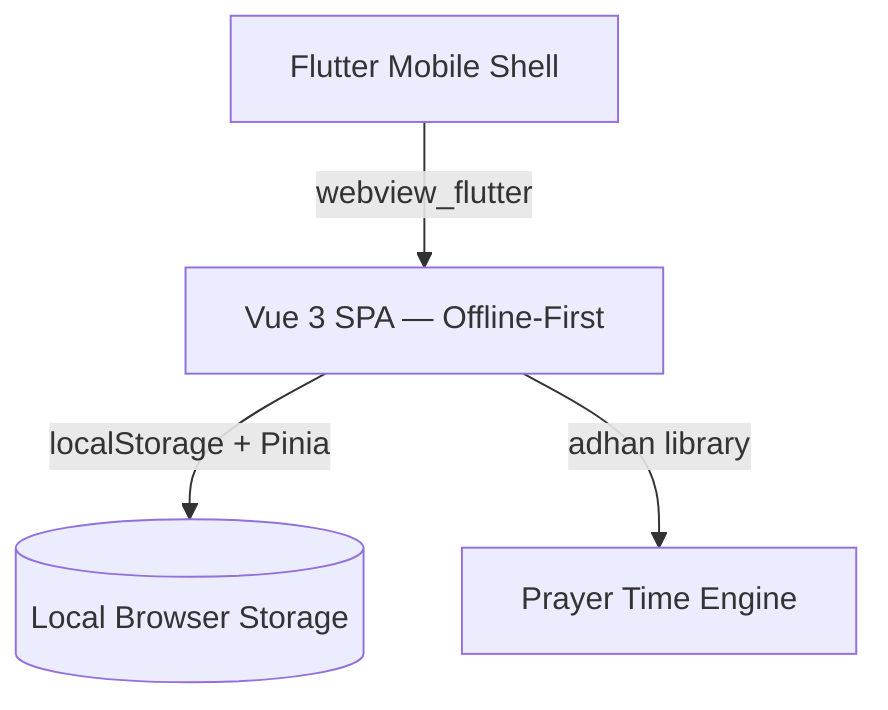

# إقامة | Iqamah — Salah Habit Establishment Platform

[](CHANGELOG.md)
[](https://vuejs.org/)
[](https://flutter.dev/)
[](https://tailwindcss.com/)
[](#)
[](http://makeapullrequest.com)
[](LICENSE)

**Iqamah (إقامة)** is a premium, offline-first Salah (Namaz) habit establishment platform for Muslims. It helps you build and maintain consistent prayer habits with granular punctuality tracking, make-up (Qaza) debt management, and motivational analytics — entirely on your own device, with no account or internet required.



---

## 🏗️ Architecture Overview

As of **v1.1.1**, the platform operates in a **fully offline, hybrid model**. The mobile client wraps the compiled offline-first Vue client inside a native WebView container, achieving 100% feature and design parity.



### 1. Web Client (Vue 3 + Vite)
A local-first Single Page Application:
- **Tailwind CSS v4:** Material Design 3-inspired color system with full light/dark mode.
- **Pinia Store (`usePrayerStore`):** All prayer logs, Qaza records, streaks, and analytics computed and persisted in `localStorage`. No HTTP calls.
- **adhan (JS):** Offline prayer time calculation based on the user's GPS coordinates.
- **OnboardingView:** Replaces the login screen. Captures name, language, and gender — stored locally.

### 2. Mobile Client (Flutter)
A lightweight Flutter WebView shell:
- **webview_flutter:** Serves the compiled Vue 3 Single Page Application locally via asset bundler, ensuring 100% UI/UX parity.
- **Platform-Safe Wrapper:** Uses Dart conditional imports (`webview_stub.dart`, `webview_mobile.dart`, `webview_web.dart`) to safely load platform-specific WebViews across Android, iOS, Web (Chrome), and Desktop.
- **System Theme Integration:** Sets native status bar and system navigation bar coloring (`#030A09`) to blend seamlessly with the app's dark visual design.

### 3. Server (ASP.NET Core 10) — Optional / Legacy
The original server implementation remains in `server/` for reference or self-hosted use. It is no longer required by the web or mobile clients in their default configuration.

---

## ✨ Features

| Feature | Web | Mobile |
|---------|-----|--------|
| 5-prayer daily tracker with quick log (tap) | ✅ | ✅ |
| Detailed log sheet (Waqt, Jamaah, Tasbih, Quran notes) | ✅ | ✅ |
| Swipe gestures (delete / mark missed) | — | ✅ |
| Qaza ledger with fulfill action | ✅ | ✅ |
| Streak counter | ✅ | ✅ |
| Analytics (punctuality split, missed reasons) | ✅ | ✅ |
| Salah time schedule + Makruh windows | ✅ | ✅ |
| Hijri date display | ✅ | — |
| JSON backup export / import | ✅ | ✅ |
| Reset Application (wipe all data) | ✅ | ✅ |
| Bilingual (Bengali / English) | ✅ | ✅ |
| Gender-aware Hayd/Nifas logging | ✅ | ✅ |
| Offline — no internet required | ✅ | ✅ |
| Light + Dark mode | ✅ | ✅ (Dark) |

---

## 💻 Web Client — Quick Start

### Prerequisites
- [Node.js v20+ or v22+](https://nodejs.org/)
- [Bun](https://bun.sh/) (recommended) or npm

### Setup
```bash
cd client
bun install
bun run dev
```
The app opens at `http://localhost:5173`. No backend needed.

### Production Build
```bash
bun run build      # TypeScript check + Vite build
bun run test:unit -- --run   # Run Vitest suite (7 tests)
bun run lint       # ESLint + Oxlint
```

---

## 📱 Mobile Client — Quick Start

### Prerequisites
- [Flutter SDK (stable)](https://docs.flutter.dev/get-started/install)
- Android SDK / Xcode (for device targets)

### Setup
```bash
cd mobile
flutter pub get
flutter run          # Connect an Android/iOS device or emulator
```

### Supported Platforms
| Platform | Status |
|----------|--------|
| Android | ✅ Primary target |
| iOS | ✅ Supported |
| Web (WASM SQLite) | ✅ `flutter run -d chrome` |
| Linux Desktop | ✅ `flutter run -d linux` |

---

## 📁 Project Structure

```
Iqamah/
├── client/                    # Vue 3 offline SPA
│   └── src/
│       ├── assets/            # Tailwind CSS + fonts
│       ├── stores/            # Pinia (auth.ts, prayer.ts)
│       ├── views/             # Dashboard, Qaza, Analytics, SalahTime, Settings, Guide, Onboarding
│       └── router/            # Route guards
├── mobile/                    # Flutter offline companion
│   └── lib/
│       ├── main.dart          # All widgets, screens, navigation
│       ├── providers/         # PrayerProvider, SalahTimeProvider
│       ├── services/          # DatabaseHelper (SQLite)
│       └── l10n/              # strings.dart (Bengali + English)
├── server/                    # ASP.NET Core 10 API (optional/legacy)
├── docs/                      # Domain model documentation
├── CHANGELOG.md               # Version history
└── README.md
```

---

## 🧪 Testing

### Web Client (Vitest)
```bash
cd client
bun run test:unit -- --run
```

### Mobile (Flutter)
```bash
cd mobile
flutter test
flutter analyze
```

---

## 🐳 Self-Hosted Server (Optional)

The original full-stack mode (Vue → ASP.NET Core → PostgreSQL) is still supported for users who want server-side multi-device sync.

```bash
# Build the Docker image
docker build -t iqamah-app .

# Run with PostgreSQL credentials
docker run -p 8080:8080 \
  -e ConnectionStrings__DefaultConnection="Host=your_host;Database=your_db;Username=user;Password=pass;SSL Mode=Require;" \
  -e Jwt__Issuer="IqamahServer" \
  -e Jwt__Audience="IqamahClient" \
  -e Jwt__SecretKey="your_secure_secret_at_least_32_chars" \
  iqamah-app
```

See [docs/domain-model.md](docs/domain-model.md) for the full server-side domain model.

---

## 🤝 Contributing

Contributions are welcome! Please read [CONTRIBUTING.md](CONTRIBUTING.md) for branch naming conventions, coding standards, and how to submit a pull request.

Please review [CODE_OF_CONDUCT.md](CODE_OF_CONDUCT.md) before participating.

## 📄 License

Distributed under the GNU GPLv3 License. See [LICENSE](LICENSE) for more information.